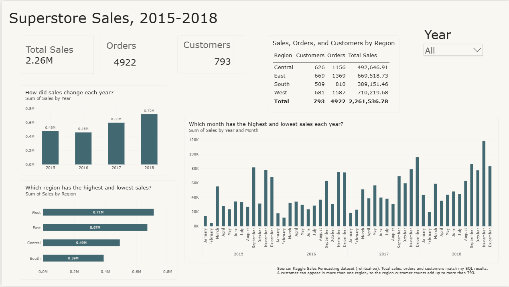

# Superstore Dashboard (Power BI)

This dashboard shows total sales, orders and customers, plus sales by year, region and month.

| Question | Visual | Checked against SQL |
|---|---|---|
| Which month has the highest and lowest sales each year? | Monthly column chart | Highest month each year: Sep 2015 = 81,623.53; Nov 2016 = 75,249.40; Dec 2017 = 95,739.12;  Nov 2018 = 117,938.16.  Lowest month each year: Feb 2015 = 4,519.89; Feb 2016 = 11,951.41; Jan 2017 = 18,542.49; Feb 2018 = 19,921.00 |
| Which region has the highest and lowest sales? | Region bar chart | Highest: West 710,219.68   Lowest: South 389,151.46 |
| How did sales change each year? | Yearly column chart | 2016 -4.3%; 2017 +30.6%; 2018 +20.3% |

Reconciliation: Total sales 2,261,536.78, orders 4,922, customers 793 and rows 9,800, all matching the SQL results.